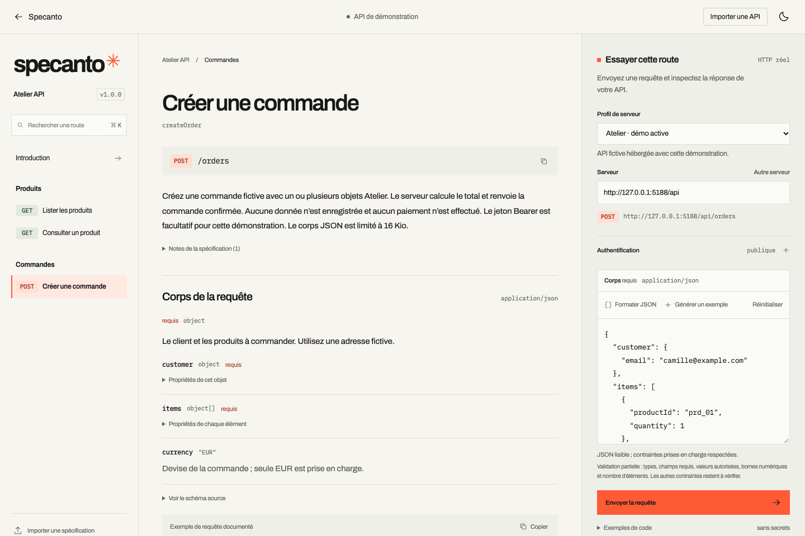
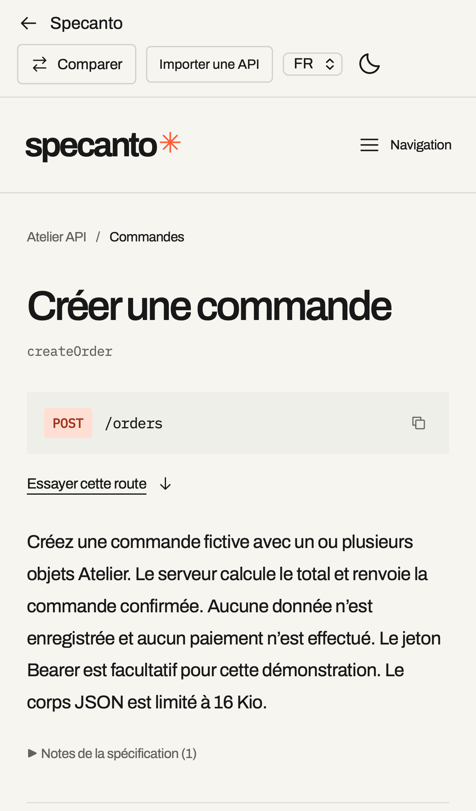

# Specanto

API documentation, with character.

Specanto turns an OpenAPI document into a searchable React reference with a manual HTTP request panel. It brings navigation, readable schemas, request examples and responses into one responsive screen.

[Français](./README.fr.md) · [Compatibility](./docs/compatibility.md) · [Contributing](./CONTRIBUTING.md) · [Roadmap](./ROADMAP.md) · [Feature proposals](./docs/features.md)

## Current delivery

Version `0.1.0` is published on [npm as `@specanto/react`](https://www.npmjs.com/package/@specanto/react) under MIT, supporting the documented OpenAPI 3.0.x/3.1.x subset. Install it in your own React application; your application controls its hosting and API destinations.

The repository also contains a showcase at `/`, an interactive demo at `/demo` and a local OpenAPI comparison screen at `/compare`. The demo uses the fictional Atelier shop API, with real HTTP requests:

| Operation | Purpose |
| --- | --- |
| `GET /api/products` | List and filter design objects |
| `GET /api/products/{id}` | Read a product |
| `POST /api/orders` | Validate and echo a fictitious order |

There is no payment, account or database. The demo server does not retain orders, log request bodies or store Bearer tokens. Its optional authentication accepts a fictitious token. Order bodies are limited to 16 KiB. Use fictional customer details, such as `camille@example.com`.



<details>
<summary>Mobile reference</summary>



</details>

## Run the project

Use Bun `1.3.14`, the version recorded in `package.json`.

```sh
bun install
bun run dev
```

Open `http://localhost:5188` for the showcase or `http://localhost:5188/demo` for the reference screen. The development command runs Vite on port `5188` and the Bun demo API on port `3001`; Vite forwards `/api`, `/openapi.json` and `/health` to that API.

To serve the production build locally:

```sh
bun run build
PORT=3001 bun run start
```

This serves the showcase, demo, OpenAPI fixture and controlled API together at `http://localhost:3001`. The health endpoint is `/health`.

## Install the React package

From your React application:

```sh
bun add @specanto/react
# or: npm install @specanto/react
# or: pnpm add @specanto/react
```

The package exports the React components, TypeScript declarations and `@specanto/react/styles.css`. It does not depend on the Railway demo.

## Install the local React package

Build and pack from this repository:

```sh
bun install
bun run build:lib
bun pm pack --filename specanto-react-0.1.0.tgz
```

Then, from your React application, install the generated archive using its actual path:

```sh
bun add /absolute/path/to/Specanto/specanto-react-0.1.0.tgz
```

React and React DOM are peer dependencies (`>=18.2.0 <20`). Your application supplies them. The package contains an ES module, TypeScript declarations and an explicit CSS export.

```tsx
import { ApiReference } from '@specanto/react';
import '@specanto/react/styles.css';

export function Documentation() {
  return <ApiReference specUrl="/openapi.json" locale="en" colorMode="light" />;
}
```

Serve your OpenAPI document at `/openapi.json`, or use an accessible HTTP(S) URL. Specanto needs no dedicated server or Specanto cloud account: it renders inside your application and sends requests directly to the selected API. The API's CORS policy still applies. The Bun server in this repository is only needed for the showcase and its controlled demo API.

## Component API

Pass exactly one of `spec` and `specUrl`.

| Prop | Description |
| --- | --- |
| `spec` | An OpenAPI object, JSON text or YAML text |
| `specUrl` | URL of an OpenAPI document; relative URLs work in the browser |
| `title` | Optional displayed title |
| `locale` | `fr` or `en`; default `fr`. Changes interface labels and known library diagnostics; OpenAPI content stays as authored. |
| `logo` | Optional React node for the desktop/mobile brand |
| `theme` | The current theme is `editorial` |
| `colorMode` | `light`, `dark` or `system` |
| `accentColor` | Optional accent color |
| `fontFamily` | Optional interface font family; your application supplies the font |
| `monoFontFamily` | Optional code font family; your application supplies the font |
| `requestTimeoutMs` | Integer from 100 to 300,000 ms; default 45,000. Invalid values block requests. |
| `serverProfiles` | Optional named HTTP(S) destinations independent of the OpenAPI document; first profile selected initially. |
| `transport` | Optional function implementing the exported `Transport` type |
| `transportMode` | `http` or `simulation`; simulation is explicitly labeled. An injected transport without a mode is labeled as a custom transport. |

See [customization](./docs/customization.md) for branding, fonts, scoped CSS and timeout examples. A permanent [Vite consumer](https://github.com/SergenYUKSEL/Specanto/tree/main/examples/consumer-vite) demonstrates archive installation and an explicitly labeled simulation.

Documents loaded by URL resolve relative API servers against their source URL. Documents passed as objects/text or imported from local files need absolute HTTP(S) API server URLs. Operation links use `#operation/{operationId}` with a URL-encoded ID.

The public entry also exports `SpecComparison`, `compareSpecs`, `parseSpec`, `loadSpec`, `searchOperations`, `exampleForSchema`, `buildRequest`, `toCurl`, `toFetch`, `toPython`, `normalizeServerProfiles`, `httpTransport` and their associated types, including `ReferenceLocale` and `SpecDiffReport`. `src/core` has no React dependency. See the [compatibility matrix](./docs/compatibility.md) before integrating an API with advanced schemas or serialization.

The console generates cURL, Fetch and Python examples from the current form, with known secret headers redacted. The JSON body editor provides field-path diagnostics, manual formatting and manual example insertion; it shares the engine’s partial validation constraints. Profiles and snippets never trigger requests automatically.

## Session and comparison

The navigation's Session panel keeps up to 20 request-history entries and 100 favorite operation IDs in component memory. History contains the operation ID, method, template path, server origin, status or classified outcome, duration and timestamp. It excludes submitted path/query values, headers, request bodies, response bodies and raw errors. Both lists can be cleared and reset when the specification changes, a file is imported, or the component is reloaded/remounted. No browser storage is used. Opening an entry navigates to documentation without replaying its request.

The standalone comparison component reads two local JSON/YAML files and compares them on an explicit click:

```tsx
import { SpecComparison } from '@specanto/react';
import '@specanto/react/styles.css';

export function VersionReview() {
  return <SpecComparison locale="en" colorMode="light" />;
}
```

`SpecComparison` accepts `locale: 'fr' | 'en'` (default `fr`) and `colorMode: 'light' | 'dark'` (default `light`). For an application-owned workflow, call `compareSpecs(before, after)` with two `NormalizedSpec` values returned by `parseSpec` or `loadSpec`. It returns changes, warnings, severity counts and a `truncated` flag.

Comparison matches operations by method and path, then reviews parameters, primary request/response media types, schema constraints and security. It is a heuristic review aid, not a full compatibility guarantee. Servers and documentation metadata are excluded. Reports are limited to 500 changes, traversal depth 16 and 20,000 work visits; truncated counts describe only returned changes. Advanced schemas and unresolved references need manual review. Files stay in memory, with no upload or API execution. See [comparison details](./docs/customization.md#specification-comparison).

## Check a change

```sh
bun run check
bun run check:consumer
bun run test:e2e
```

`check` runs lint, TypeScript checks, unit tests, third-party notice verification and both builds. `check:consumer` installs the archive in separate React 18.2 and 19.3 consumers, then verifies strict TypeScript, public JS/CSS exports and builds. Browser checks run Chromium and mobile WebKit against the demo and an isolated integration host. Install the browsers if missing with `bunx playwright install chromium webkit`.

GitHub Actions runs these checks for main pushes and pull requests. In CI, browser tests use the production demo build. See the [manual release procedure](./docs/releasing.md); the workflow does not publish npm packages.

The individual commands are `bun run lint`, `bun run typecheck`, `bun run test`, `bun run build:lib` and `bun run build:demo`.

## Deployment

The public showcase and demo deploy from this repository with the Railway CLI. The React library is installed separately into the consuming application.

[Live showcase](https://specanto-demo-production.up.railway.app) · [Interactive demo](https://specanto-demo-production.up.railway.app/demo) · [OpenAPI comparison](https://specanto-demo-production.up.railway.app/compare)

- Project: `agile-dream` (`e7e1ab33-b677-4537-bb14-c43201359ef5`).
- Environment: `production` (`a1e0cb54-c0a1-481e-92b4-7853b4c8d561`).
- Service: `specanto-demo` (`ac4e2b9e-b881-45bc-b75f-34d4952b9bc1`).
- [Railway project](https://railway.com/project/e7e1ab33-b677-4537-bb14-c43201359ef5?environmentId=a1e0cb54-c0a1-481e-92b4-7853b4c8d561).

Deploy with explicit scope:

```sh
railway up --project e7e1ab33-b677-4537-bb14-c43201359ef5 \
  --environment a1e0cb54-c0a1-481e-92b4-7853b4c8d561 \
  --service ac4e2b9e-b881-45bc-b75f-34d4952b9bc1 --detach
```

Railway builds the root Dockerfile with Bun 1.3.14 and runs the stateless server. The service uses `PORT=3000`, the same port as its generated domain, and `/health` as its startup healthcheck. Verify the deployment status and the public `/health`, `/demo`, `/compare` and `/api/products` endpoints after deployment. An upload alone does not confirm a healthy deployment.

The browser suite can target a production container or the live service:

```sh
SPECANTO_TEST_URL=http://localhost:3000 bun run test:e2e
```

## Licenses and release status

Specanto is licensed under [MIT](./LICENSE). Commercial use, modification and redistribution are permitted subject to the license's notice requirements. Version `0.1.0` is publicly available on [npm](https://www.npmjs.com/package/@specanto/react).

[Third-party notices](./THIRD_PARTY_NOTICES.md) preserve dependency and demo font licenses. [Changelog](./CHANGELOG.md) records the published version.
