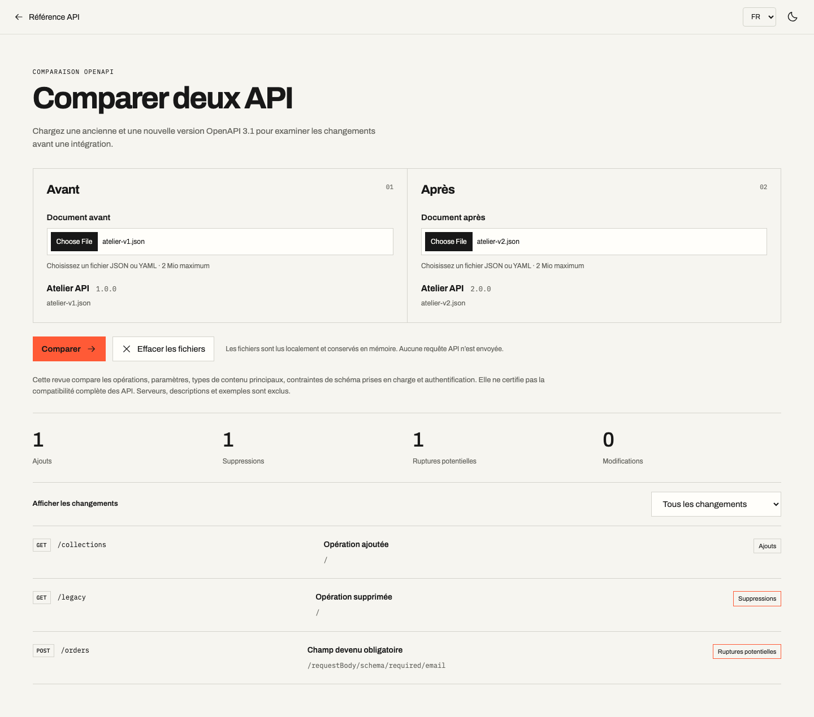
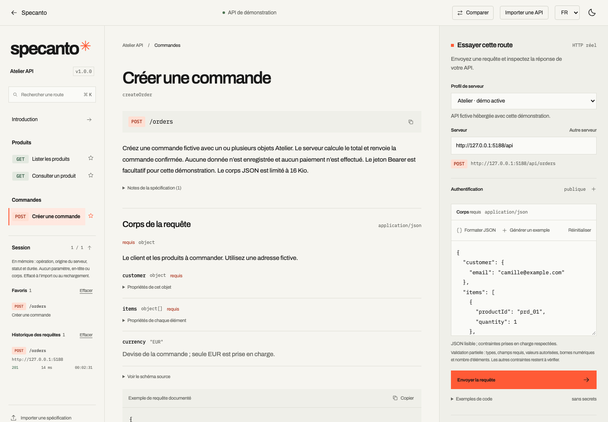

# Fonctionnalités livrées

Les six fonctionnalités proposées sont intégrées au dépôt au 13 octobre 2026. Elles complètent le MVP et restent utilisables dans une bibliothèque React sans service Specanto dédié.

| Statut | Fonctionnalité | Bénéfice concret | Périmètre livré |
| --- | --- | --- | --- |
| Livré | Exemples de code multilangages | Copier une requête directement dans un projet JavaScript ou Python. | Onglets cURL, Fetch et Python construits depuis le formulaire actuel, copie et masquage des en-têtes secrets par défaut. |
| Livré | Profils de serveurs | Passer facilement entre local, staging et production. | Noms, URL et descriptions fournis par l’intégrateur hors OpenAPI ; sélection conservée entre les routes, effacement des identifiants au changement d’origine et annulation au changement de destination. |
| Livré | Éditeur JSON guidé | Corriger un corps de requête sans chercher l'erreur dans un grand JSON. | Premier diagnostic au chemin du champ, formatage manuel préservant les littéraux et insertion manuelle d’un exemple documenté ou généré. Validation limitée aux contraintes prises en charge. |
| Livré | Comparaison de deux spécifications | Repérer ce qui a changé avant d'intégrer une nouvelle version d'API. | Composant `SpecComparison`, moteur `compareSpecs` et écran `/compare` : fichiers JSON/YAML locaux, opérations, paramètres, types de contenu principaux, schémas et authentification ; filtres et classification des ruptures potentielles. |
| Livré | Historique temporaire et favoris | Retrouver les essais et routes utiles pendant une session. | Les 20 derniers résultats de requête et jusqu’à 100 opérations favorites, en mémoire et effaçables. Historique limité à l’opération, l’origine du serveur, le résultat, la durée et l’heure ; aucun paramètre soumis, en-tête ou corps conservé. |
| Livré | Interface FR/EN configurable | Intégrer Specanto dans une application internationale. | Option `locale`, libellés, contrôles accessibles, diagnostics connus, historique et comparaison en français ou anglais. Le contenu rédigé dans OpenAPI garde sa langue d’origine. |

## Limites de cette livraison

La comparaison lit chaque fichier localement, avec une limite de 2 Mio par document. Elle exclut les serveurs, descriptions et exemples ; les valeurs privées des exemples et des énumérations ne sont pas copiées dans le rapport. Les limites de parcours et de profondeur, les références non résolues et les constructions avancées produisent des avertissements. Le rapport affiche au plus 500 changements et signale toute troncature. Il constitue une aide à la revue du sous-ensemble documenté, sans certifier la compatibilité complète des API.

L’historique et les favoris sont remis à zéro lors d’un import ou d’un rechargement. Ouvrir une entrée revient à la documentation de l’opération ; aucune requête n’est rejouée. Les snippets comprennent les corps et paramètres actuels, même lorsque les en-têtes secrets sont masqués.

Les 224 tests unitaires et d’intégration, les 112 contrôles Chromium/WebKit mobile contre le build de production et les consommateurs empaquetés React 18.2/19.3 passent. Le package reste privé et non publié sur npm ; la licence du projet reste à choisir.

## Extensions selon les demandes d'intégration

OpenAPI 3.0, OAuth/OIDC, multipart, références externes et streaming méritent des lots séparés. Ils changent davantage les garanties du moteur et demandent des cas d'usage réels avant de fixer leur priorité. Un portail multi-API peut arriver plus tard, lorsque plusieurs équipes utilisent effectivement le composant.

## Aperçus

